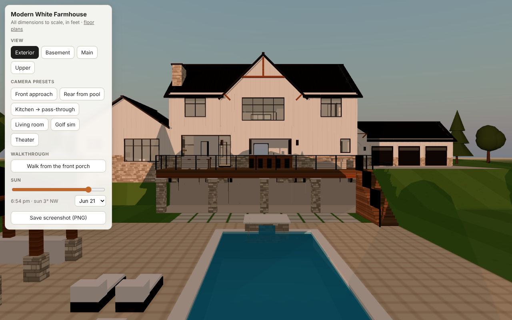
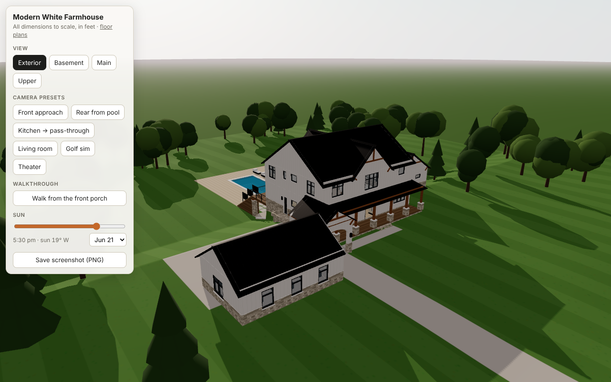
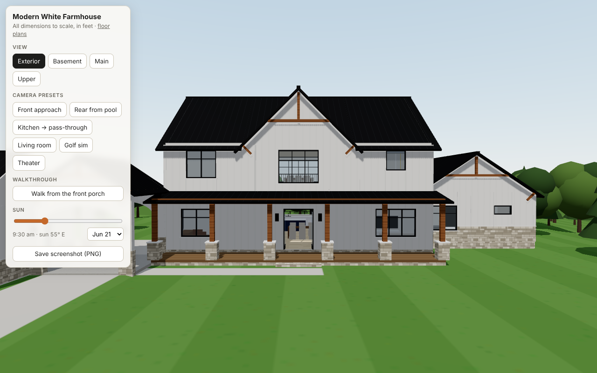
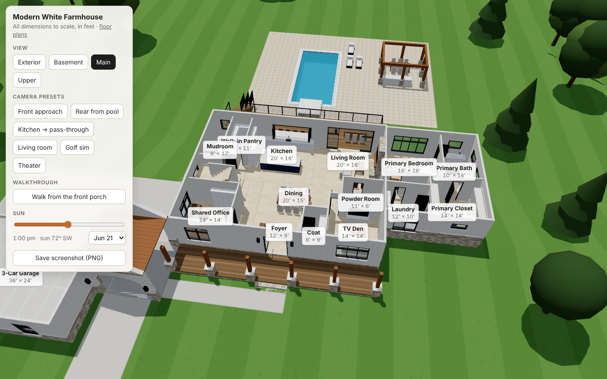
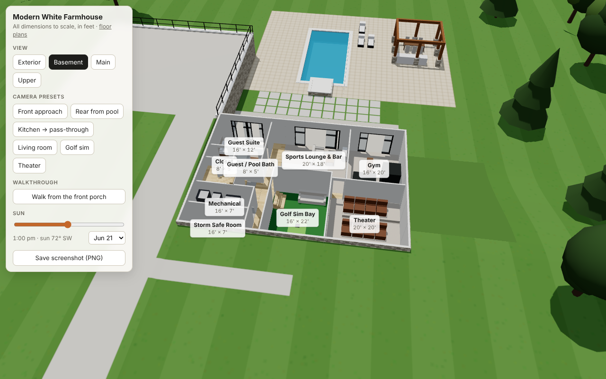
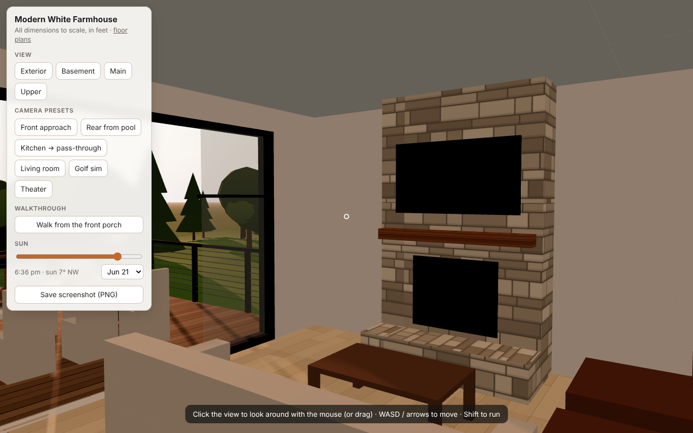
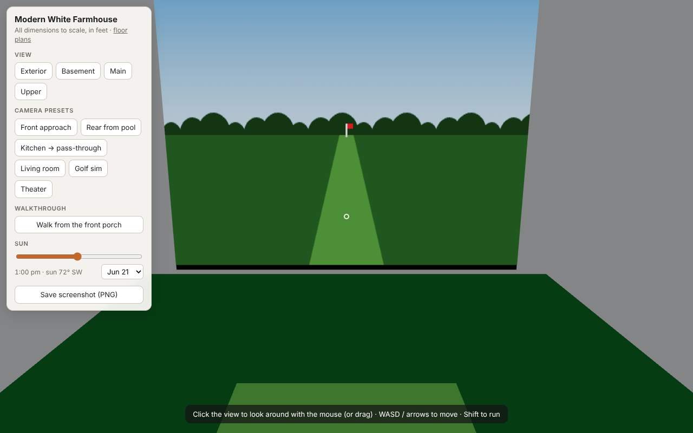

# Modern White Farmhouse — 3D model

An interactive, to-scale (feet) 3D model of the house and site, built with
Three.js and Vite, plus a 2D plan-review page drawn from the same data.



## Run it

```bash
cd house-model
npm install
npm run dev          # http://localhost:5173  (3D model)
                     # http://localhost:5173/plans.html  (floor plans)
npm run build        # static site in dist/
```

## Controls

| | |
|---|---|
| **Exterior** | Orbit view of the house and site. Drag to orbit, right-drag to pan, scroll to zoom. |
| **Basement / Main / Upper** | Dollhouse view of one floor: roof and floors above hidden, room names and dimensions shown. |
| **Camera presets** | Front approach, rear from the pool, kitchen looking out the pass-through, living room, golf sim, theater. |
| **Walkthrough** | Eye height 6'-2". Click the view to capture the mouse (or click-and-drag), WASD / arrows to move, Shift to run, Esc to release. Walls, railings and glass block you; stairs, steps and the walkout terrain are followed. |
| **Sun** | Time-of-day slider and month. Sun position is computed from the latitude in the config; shadows, sky and window glow follow it. |
| **Save screenshot** | Downloads the current view as a PNG. |

## Changing the plan

Everything — room positions and sizes, doors, windows, stairs, ceiling heights,
porch, deck, roofs, terrain, pool, pavilion, camera presets, sun latitude — lives
in **`src/config/house.js`**. Walls and hallways are derived from the room
rectangles automatically, and both the 3D model and the plan page rebuild from
that file. The plan page flags any hallway narrower than 3'-6" and any room that
can't be reached from the stairs.

Finishes are set per floor with `finish: 'good' | 'better'` and defined in
`finishLevels` (floor materials by room type, cabinets, island, counters,
fixtures, tub type). Rooms marked `finished: false` use the `unfinished` level,
and any room can override it with `finish: { floor, walls, roughIn }`. Current
setup: main floor and basement **Better** (wide-plank light oak LVP, slate-look
mudroom tile, white shaker cabinets, navy island, white quartz, matte black
fixtures), upstairs **Good** (carpet, LVP in baths and laundry, white fixtures,
fiberglass tub units), gym in sealed concrete with stall mats and painted block,
theater and attic in bare drywall with exposed rough-in, all interior doors
8 ft and black.

Plan axes: `x` runs left → right as seen from the street (south → north), `y`
runs from the rear wall (west, pool side) toward the front (east, street).
Elevations are relative to the main floor.

## Code map

| File | What it does |
|---|---|
| `src/config/house.js` | All dimensions and positions |
| `src/model/layout.js` | Walls, hallways, areas and plan checks from the room rectangles |
| `src/model/terrain.js` | Ground height anywhere on the site (shared by the mesh and the walkthrough) |
| `src/app/house.js` | Walls, cladding, windows/doors, floors, ceilings, stairs, labels |
| `src/app/furniture.js` | Block furniture |
| `src/app/roofs.js` | Gable, cross-gable, shed and hip roofs, cedar gable timbers |
| `src/app/exterior.js` | Porch, deck, breezeway arch, foundations, lanterns |
| `src/app/site.js` | Terrain, pool, hot tub, pavilion, low patio wall, trees |
| `src/app/sun.js` | Solar position and lighting |
| `src/app/walk.js` | First-person walkthrough with collisions |
| `src/plan/plan2d.js` | 2D plan drawings |

## Screenshots

| | |
|---|---|
|  |  |
|  |  |
|  |  |
